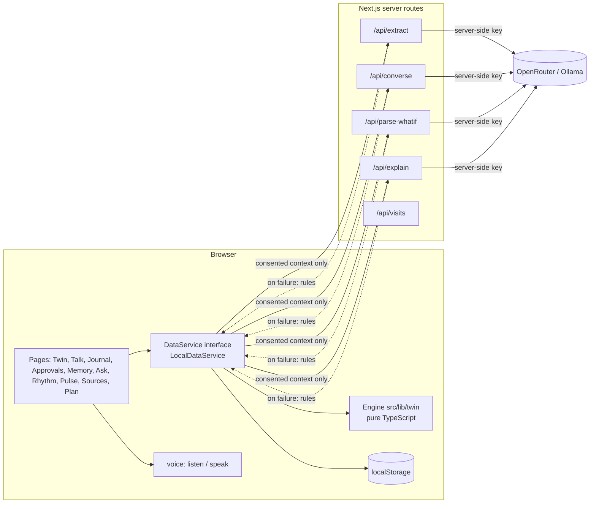
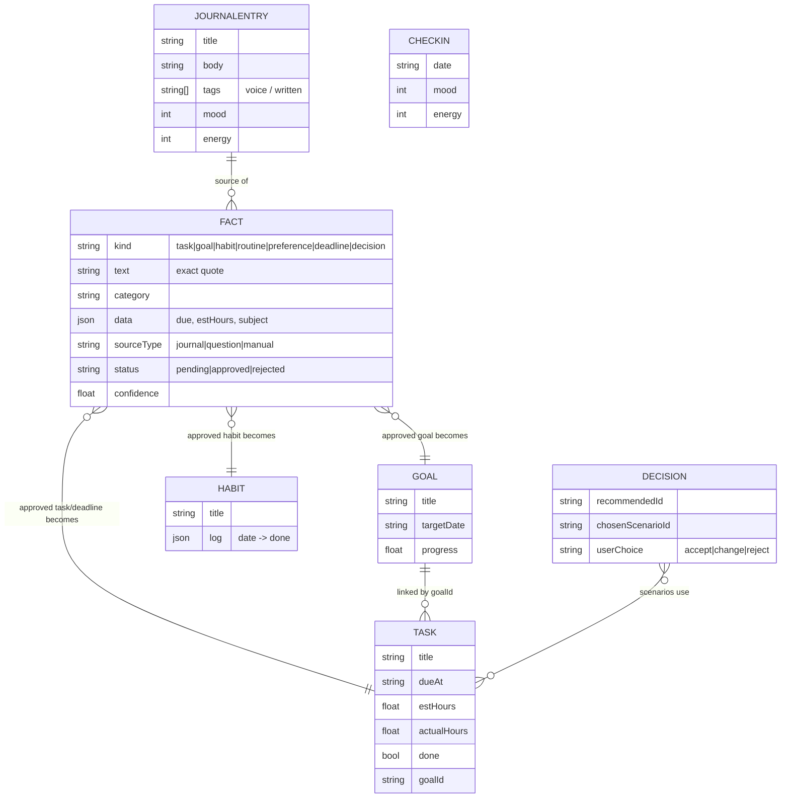
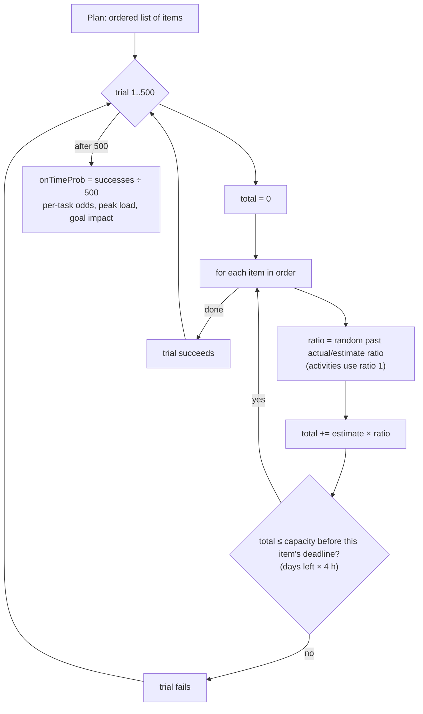
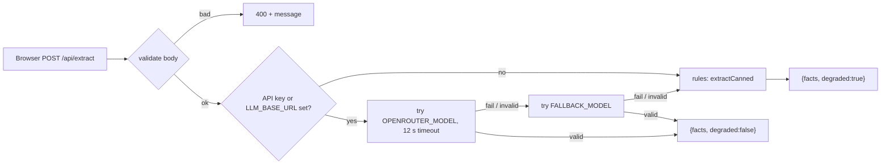
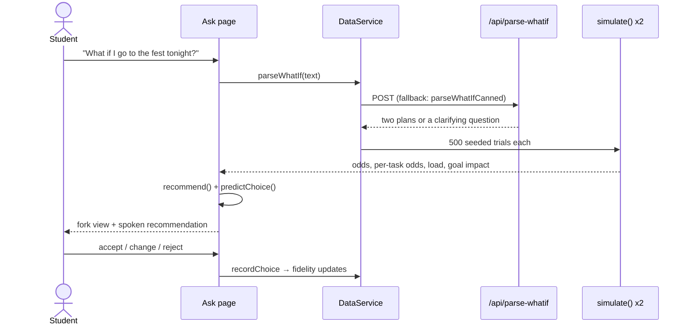

# Paroh: the complete guide

For someone who knows **HTML, CSS, JavaScript and Python**. Paroh adds **TypeScript, React, Next.js (App Router and
server routes), the Web Speech API, an LLM API with fallbacks, Monte Carlo simulation and SVG visualisation**.
Each is explained from zero and tied to real files.

> **Read this first: your role.** Paroh was a GATEWAYS 2026 hackathon team project. The README credits
> Frank Ndagula (Developer), Merel Riha D souza (Ideation), Siddharth Bhat (Front end) and K S Pankaj (Research).
> In interviews, describe your real contribution and say it was a team build. Understanding every part of it, as this
> guide teaches, is a strength; claiming you built all of it alone is a risk. See the last section.

---

## Table of contents

1. [The project in one minute](#1-the-project-in-one-minute)
2. [The tech stack, explained from zero](#2-the-tech-stack-explained-from-zero)
3. [Architecture](#3-architecture)
4. [The data model](#4-the-data-model)
5. [The engine: the maths, explained](#5-the-engine-the-maths-explained)
6. [AI with a safety net](#6-ai-with-a-safety-net)
7. [Consent and privacy](#7-consent-and-privacy)
8. [File-by-file tour](#8-file-by-file-tour)
9. [Main flows with diagrams](#9-main-flows-with-diagrams)
10. [Testing](#10-testing)
11. [Decisions and why](#11-decisions-and-why)
12. [Honest weaknesses and fixes](#12-honest-weaknesses-and-fixes)
13. [Build it yourself from scratch](#13-build-it-yourself-from-scratch)
14. [Change requests you might get](#14-change-requests-you-might-get)
15. [Interview and recruiter questions](#15-interview-and-recruiter-questions)
16. [Glossary](#16-glossary)
17. [Self-check exercises](#17-self-check-exercises)

---

## 1. The project in one minute

**Theme:** "HumanTwin AI: the intelligent digital twin of a person", for students.

**What it does:** The twin (a line-art character) asks you questions out loud. Your answers and journal entries become
**candidate facts** ("I need to finish my chemistry lab report, about 3 hours"). You **approve** each fact before the twin learns it.
Approved facts become real tasks, goals and habits. The twin then:

- shows what it knows (stars, load, heatmap, memory graph, calendar, year wheel),
- simulates **what-if** choices ("What if I go to the fest tonight?") with on-time probabilities,
- speaks a recommendation and learns from your accept/change/reject (a **fidelity** score).

**Elevator pitch:**

> "Paroh is a Next.js app that builds an explainable model of a student from data they approve. Text and voice go through
> server routes that call an LLM for structure only, with a rule-based fallback so it always works. Every number, from weekly
> load to what-if odds, is computed in plain TypeScript: the what-if engine runs a seeded Monte Carlo simulation over the
> student's own estimate-versus-actual history. Nothing enters the twin without consent."

---

## 2. The tech stack, explained from zero

### 2.1 TypeScript

JavaScript with types. `interface Task { title: string; estHours: number; done: boolean }` describes the shape;
the compiler catches mistakes before running. Union types like `"pending" | "approved" | "rejected"` limit values.

### 2.2 React

UI from **components** (functions returning JSX). `useState` stores values that re-render the UI when changed; `useEffect` runs side effects
(load data, start the mic). Think of each page as a function of its data.

### 2.3 Next.js (App Router)

A framework on top of React that adds **routing by folders** and **server code** in the same project.

- `src/app/page.tsx` → `/`; `src/app/talk/page.tsx` → `/talk`. The folder name is the URL.
- `src/app/layout.tsx` wraps every page (navbar, fonts, styles).
- `src/app/api/extract/route.ts` exporting `POST` → an API endpoint `POST /api/extract` that runs **on the server**.
- `"use client"` at the top of a file means it runs in the browser (needed for state, events, speech).

Why it matters here: the LLM API key must stay secret, so LLM calls happen in server routes; the browser only calls `/api/...`.

Python comparison: like Flask serving both your HTML pages and your `/api` endpoints, but with React for the pages.

### 2.4 Web Speech API

Two browser features:

- **SpeechRecognition** (`src/lib/voice/listen.ts`): microphone → text. Chrome uses Google's cloud for this, which the app discloses.
- **speechSynthesis** (`src/lib/voice/speak.ts`): text → voice. The twin speaks sentence by sentence, prefers an Indian English voice, can be stopped.

No audio is recorded or stored; only the text is kept.

### 2.5 LLM via OpenRouter

OpenRouter is one API in front of many AI models. Server routes send a system prompt + user text and ask for **JSON only**.
Settings come from `.env.local`: `OPENROUTER_API_KEY`, `OPENROUTER_MODEL`, `OPENROUTER_FALLBACK_MODEL`, or `LLM_BASE_URL` for a local Ollama.

### 2.6 motion (Framer Motion) and SVG

`motion` animates React components (fact cards flying into the twin's "mind point"). All charts (heatmap, memory graph, year wheel, fork)
are hand-made **SVG**, no chart library. Animations use only `transform`/`opacity` for smoothness and respect `prefers-reduced-motion`.

### 2.7 localStorage

All data lives in the browser under `paroh-local-data-v1`. No database server. A demo sample student is loaded on first visit.

### 2.8 Vitest

The test runner (like pytest). Tests cover the engine, the data service, AI fallbacks and routes.

---

## 3. Architecture



Key rule: **the UI talks only to `DataService`** (an interface). Pages never touch `localStorage` or `fetch` directly. That makes it possible
to swap `LocalDataService` for a real backend later without touching pages. This is the **repository / service pattern**.

---

## 4. The data model

From `src/lib/types.ts`:



Plus `MemoryItem` (for the graph) and `ConsentSettings` (per-category on/off).

**Fact lifecycle:** `pending` → (you approve) → `approved` → structured data created (task/goal/habit) → shows on every screen. Or `rejected` ("not me").

---

## 5. The engine: the maths, explained

All in `src/lib/twin/`, pure TypeScript (no React, no network), so it is testable and explainable. The LLM never produces numbers.

### 5.1 Estimation bias (`estimationBias`)

For each category, average of `actualHours / estHours` over finished tasks (needs at least 3, else 1).
If you estimate 2 h and usually take 3 h, your study bias is 1.5. **Personalisation from your own history.**

### 5.2 Weekly load (`load`)

```
hours = Σ (estHours × bias[category]) for open tasks due in the next 7 days
load% = hours ÷ (4 free hours × 7 days) × 100
```

### 5.3 Habit consistency

Share of habits ticked per day over the last 14 days.

### 5.4 Focus heatmap

A 7 × 24 grid (weekday × hour). Each finished task adds its hours at the hour it was completed. Normalised to 0..1 by the max cell.

### 5.5 The what-if simulation (`scenarios.ts`)

**Step 1: parse the question into two plans** (`parseWhatIfCanned`, or the LLM route with this as fallback):

- An **activity** ("go to the fest tonight", "gym", "a shift") → plan A: the activity first (with stated hours or a typical length: fest 4 h, gym 1.5 h), then this week's tasks; plan B: stick to the plan.
- "**X instead of Y**" (two kinds of work) → X first vs Y first.
- One kind of work → that first vs deadline order.
- Nothing placeable → ask one clarifying question.

Plans use only the student's **real open tasks**; deadlines are never invented.

**Step 2: simulate each plan 500 times** (`simulate`), a **Monte Carlo simulation**:



- Picking a random past ratio is **bootstrap resampling**: your real history decides how often you overrun.
- With no history, it uses a log-normal-ish spread around the mean.
- **Order matters:** doing the fest first eats time from tasks due tomorrow.
- The random generator is **seeded** (`random(seed)` is a linear congruential generator; `stableHash` is FNV-1a). Same question, same data → same answer. That makes results reproducible and testable.

**Step 3: recommend** (`recommend`):

```
score = onTimeProb + 0.12 × goalImpact − 0.08 × peakLoad
```

Highest score wins. Simple, explainable weights.

**Step 4: learn** (`predictChoice`, `recordChoice`): the twin predicts which option you will pick from your last 10 decisions;
**fidelity** = how often its prediction matched your actual choice (last 5).

### 5.6 Memory, conflicts and staleness (`memory.ts`)

`detectConflicts` groups approved facts of the same kind about the same **subject** (words minus time words and filler) that say different things,
e.g. "I focus best in the morning" vs "I focus best at night". These show as chips in Ask so you can fix them. `staleFacts` flags old facts.

### 5.7 Memory graph, insights, pulse

- `memoryGraph.ts`: nodes (facts, domains, tasks, goals, habits) and edges for the Obsidian-style graph.
- `insights.ts`: plain-language observations and "tomorrow you will probably need".
- `pulseWhispers.ts`: load spikes, deadline risk (same simulation), streaks at risk, for the Pulse feed.

---

## 6. AI with a safety net

Every route follows the same pattern:



Details in `src/lib/ai/openRouter.ts` and `src/app/api/extract/route.ts`:

- **Timeout** with `AbortController` (12 s) so the demo never hangs.
- **Model fallback chain**, then **rules**. The UI shows "degraded" mode honestly.
- **Validation of model output:** kinds and categories must be from the allowed sets; `text` must be an **exact quote** of the input
  (`originalText.includes(text)`), which stops the model from paraphrasing or inventing interpretations. Confidence is clamped 0..1.
- **Prompt rules:** extract only what is stated, no emotional or clinical interpretation, resolve relative dates using today's date.
- **Errors never leak the key:** the catch block deliberately ignores request details.
- `parseJsonObject` strips Markdown code fences that models sometimes add.

---

## 7. Consent and privacy

- **Approval gate:** nothing becomes knowledge until you approve it, from any source (Talk, Journal, connector samples).
- **Per-category consent** (journal, tasks, habits, mood, planner, voice, decisions). `buildTwinContext(consent)` builds the summary sent to the model from **consented categories only**.
- **"What is sent to the model" preview** on Sources shrinks when you switch a category off.
- **No audio stored.** Browser speech recognition may use the vendor's service (disclosed).
- **Not a therapy product:** wording rules forbid clinical language; mood/energy is a 1-5 planning check-in.
- **Honest claims:** connectors (Gmail, WhatsApp, Telegram, Calendar) are roadmap; Pulse runs on sample data while the tab is open; the twin is an approximation with a fidelity score.
- `/api/visits`: an anonymous counter (one number, nothing about the visitor).

---

## 8. File-by-file tour

| Path | What it does |
|------|--------------|
| `src/app/layout.tsx` | Root layout: fonts, global CSS, shell |
| `src/app/page.tsx` | Twin dashboard: face, stars, load, habits, fidelity, heatmap, coming up, "how well she knows you", "what changed" |
| `src/app/welcome/` | First-visit consent screen |
| `src/app/talk/page.tsx` | Guided questions and free-talk voice journal; fact cards; approve animation |
| `src/app/journal/` | Write or dictate entries; history with All/Voice/Written tabs |
| `src/app/approvals/` | Tray of pending facts |
| `src/app/memory/page.tsx` | Draggable memory graph |
| `src/app/ask/page.tsx` | What-if: clarify, fork, odds, spoken recommendation, feedback |
| `src/app/rhythm/page.tsx` | Habit chains, energy/mood ribbon, estimate vs actual |
| `src/app/pulse/page.tsx` | 30-second re-scan feed |
| `src/app/sources/page.tsx` | Live vs roadmap sources, consent toggles, payload preview, delete all |
| `src/app/plan/page.tsx` | Month calendar and year wheel |
| `src/app/dataService.ts` | The single `DataService` instance |
| `src/app/factActions.ts`, `lastChange.ts`, `bloomGrowth.ts` | Approve/reject helpers, "what changed" diff, visual growth |
| `src/app/api/extract` | Text → candidate facts |
| `src/app/api/converse` | Conversational reply + follow-up + facts + intent |
| `src/app/api/parse-whatif` | What-if sentence → two plans (or a clarifying question) |
| `src/app/api/explain` | Plain-language explanation of a comparison; must not invent numbers |
| `src/app/api/visits` | Anonymous counter (Upstash Redis or counterapi.dev) |
| `src/lib/types.ts` | Data model |
| `src/lib/data/DataService.ts` | The interface: CRUD repos, consent, twin state, conflicts, retrieve, insights, what-if |
| `src/lib/data/LocalDataService.ts` | localStorage implementation; question order (least-known area first); approval → structured data; goal horizons ("in 2 years") |
| `src/lib/twin/*` | The engine (section 5) |
| `src/lib/ai/*` | LLM helper, context builder, relevant-fact retrieval, rule-based extraction |
| `src/lib/voice/*` | Speech in and out |
| `src/mock/*` | Labelled sample student and connector samples |
| `src/components/*` | UI pieces (TwinFace, cards, charts, fx) |
| `scripts/check-openrouter.mjs` | Checks the LLM config |
| `docs/*` | Hackathon plan, design system, handoff, use cases |

---

## 9. Main flows with diagrams

### Teach the twin by voice

```mermaid
sequenceDiagram
  actor S as Student
  participant T as Talk page
  participant L as listen.ts
  participant D as DataService
  participant API as /api/converse + /api/extract
  participant E as Engine
  T->>S: speaks question about least-known area (speak.ts)
  S->>L: answers (Space to start/stop)
  L-->>T: transcript text
  T->>D: converse(utterance, history)
  D->>API: POST with consented context
  API-->>D: reply + candidate facts (or degraded rules)
  D-->>T: fact cards (pending)
  S->>T: Approve
  T->>D: facts.upsert(status approved) → creates Task/Goal/Habit
  D->>E: recompute twin state
  T-->>S: card flies into mind point; dashboard numbers move
```

### Ask a what-if



---

## 10. Testing

```bash
npm test
```

| Test | Covers |
|------|--------|
| `lib/twin/twin.test.ts` | bias, load, heatmap, twin state |
| `lib/twin/memory.test.ts` | conflicts, staleness |
| `lib/twin/memoryGraph.test.ts`, `insights.test.ts`, `pulseWhispers.test.ts` | graph, insights, whispers |
| `lib/data/LocalDataService.test.ts` | approval → structured data, consent, questions |
| `lib/ai/*.test.ts` | context building, retrieval, OpenRouter helper, route fallbacks |
| `mock/sample.test.ts` | sample data integrity |
| `app/api/visits/route.test.ts` | counter route |

To check the fallback by hand: remove `OPENROUTER_API_KEY` from `.env.local`, restart, and confirm everything still works in degraded mode.

---

## 11. Decisions and why

| Decision | Why | Trade-off |
|----------|-----|-----------|
| Next.js | Pages and secret-holding server routes in one deploy on Vercel | Framework learning curve |
| LLM only structures and explains | Numbers must be correct and explainable | Less "magic" |
| Rules fallback everywhere | Demo never breaks; works with no key | Rules are less flexible |
| Exact-quote facts | No hallucinated interpretations | Misses implied facts |
| Approval gate | Trust and consent | One extra tap per fact |
| localStorage | No backend in a one-night hackathon | One device, no sync |
| DataService interface | Swap storage later without touching UI | More boilerplate |
| Seeded Monte Carlo | Uses real history, reproducible | Simplified model (4 free hours/day) |
| Custom SVG charts | Full design control, small bundle | More code |
| Not a therapy product | Ethics and safety | Mood is only a planning signal |

---

## 12. Honest weaknesses and fixes

1. **Fixed 4 free hours per day.** *Fix:* learn capacity from the calendar or from check-ins.
2. **Keyword groups in the what-if parser** (exam, project, seminar, portfolio) are hard-coded. *Fix:* rely on the LLM route more, keeping rules as fallback.
3. **Single device.** *Fix:* a real `DataService` backed by Supabase with row-level security.
4. **Speech works best in Chrome** and uses the vendor's cloud. *Fix:* on-device speech (e.g. Whisper in WebAssembly) behind the same `listen` interface.
5. **Recommendation weights are hand-picked.** *Fix:* tune them from the student's feedback.
6. **Connectors are previews only.** *Fix:* OAuth-based Gmail/Calendar readers that still feed the approval gate.
7. **Docs mention two different sample names** ("Asha" in older plans, "Pankaj (sample)" in the README). Keep them consistent.

---

## 13. Build it yourself from scratch

Rebuild a smaller version alone; that is what truly makes it yours.

1. `npx create-next-app@latest twin --ts --app`. One page listing tasks from a hard-coded array.
2. `types.ts` and a `DataService` interface; a `LocalDataService` with localStorage.
3. Engine: `estimationBias`, `load`. Tests with Vitest.
4. Journal page; a rule-based extractor ("finish X by Friday, 3 hours" → task fact).
5. Approvals: pending → approved creates a task.
6. Ask: two hard-coded plans; write `simulate` with 500 seeded trials; show the odds.
7. Server route `/api/extract` calling an LLM with the rules fallback and a timeout.
8. Voice: `SpeechRecognition` for input, `speechSynthesis` for the reply.
9. Consent toggles and the payload preview.
10. Dashboards in SVG: load bar, heatmap.

Time: 4 to 6 weekends.

---

## 14. Change requests you might get

### "Change free hours per day from 4 to 6."

`load(tasks, now, availableHoursPerDay = 4)` in `twin/index.ts` and `capacity()` (`days * 4`) in `scenarios.ts`. Better: make it a setting stored via `DataService` and pass it in. Update tests.

### "Add 'hackathon' as a what-if activity of 24 hours."

Add `{ words: /\b(hackathon)\b/, hours: 24, priority: "neutral" }` to `ACTIVITIES` in `scenarios.ts`; add a test.

### "Add a new fact kind: 'skill'."

Extend `FactKind` in `types.ts`, the `factKinds` set in each API route, the extraction prompt, `extractCanned` rules, and the approval mapping in `LocalDataService`. Then show it on the Twin page.

### "Make the recommendation care more about goals."

Raise `0.12` in `recommend()`. Explain the trade-off: higher goal weight may recommend plans with lower on-time odds.

### "Use a local model instead of OpenRouter."

Set `LLM_BASE_URL=http://localhost:11434/v1` and `OPENROUTER_MODEL` to the Ollama model name. No code change.

### "Export my data."

Add `exportJSON()` to `DataService`, implemented in `LocalDataService` by serialising its state; a button on Sources downloads it.

---

## 15. Interview and recruiter questions

**Q: What is a digital twin here?** A model of the student built only from approved facts and their own data, used to predict and explain choices, with a fidelity score showing how well it matches reality.

**Q: How do you compute the what-if probabilities?** Monte Carlo: 500 trials per plan, each resampling the student's real actual-to-estimate ratios, checking each task against the hours available before its deadline. Seeded so results are reproducible.

**Q: Why not let the LLM decide?** LLMs are not reliable at arithmetic and cannot be audited. The LLM only turns text into structure and words; maths is deterministic TypeScript.

**Q: What if the AI is down?** Every route tries the main model, then a fallback model, then rules, and returns `degraded: true`. The UI keeps working.

**Q: How do you stop hallucinated facts?** The model must return exact quotes from the input; anything else is rejected. And the student approves every fact.

**Q: Where is the API key?** Server-side environment variables, used only in Next.js route handlers, never sent to the browser.

**Q: How is privacy handled?** Approval gate, per-category consent, a preview of exactly what is sent to the model, no audio stored, local storage only.

**Q: What was your role?** Answer truthfully (see below).

**Q: What would you do next?** Real backend with sync, learned capacity, real connectors behind the same consent gate, and tuning the recommendation from feedback.

---

## 16. Glossary

| Word | Meaning |
|------|---------|
| App Router | Next.js routing where folders are URLs |
| Bootstrap resampling | Drawing random samples from your own past data |
| Consent gate | Nothing is learned without approval |
| Degraded mode | Rule-based fallback when the AI is unavailable |
| Digital twin | A data model of a real thing or person |
| Fidelity | How often the twin's predicted choice matched yours |
| LCG | Linear congruential generator, a simple seeded random generator |
| Monte Carlo | Estimating probabilities by running many random trials |
| Route handler | Server function for `/api/...` in Next.js |
| Seed | Starting value that makes "random" results repeatable |
| speechSynthesis | Browser text-to-speech |
| SpeechRecognition | Browser speech-to-text |

---

## 17. Self-check exercises

1. Compute by hand: tasks 3 h and 2 h due tomorrow, bias 1.5, 4 free hours/day. Load? Likely on time?
2. Explain why the simulation is seeded.
3. Add the "hackathon" activity with a test.
4. Turn off the API key and walk through the extract fallback.
5. Draw the fact lifecycle from memory.

---

## Talking about this project (team + AI-assisted)

This one needs extra care because it was a **team** hackathon build, and the plan in `docs/NIGHT_PLAN.md` says it was built with AI agents.

A truthful way to say it:

> "Paroh was our team's GATEWAYS 2026 hackathon project. My role was research (adapt this to what you really did).
> Since then I have studied the whole codebase, and I can explain the architecture, the Monte Carlo what-if engine,
> the AI fallback chain and the consent design, and make changes to it."

- Never present a team project as solo work. Recruiters can see the README and the commit history.
- Your strongest move: build the small version in section 13 **yourself** and show both. "Here is the team project, and here is my own rebuild of its core engine."
